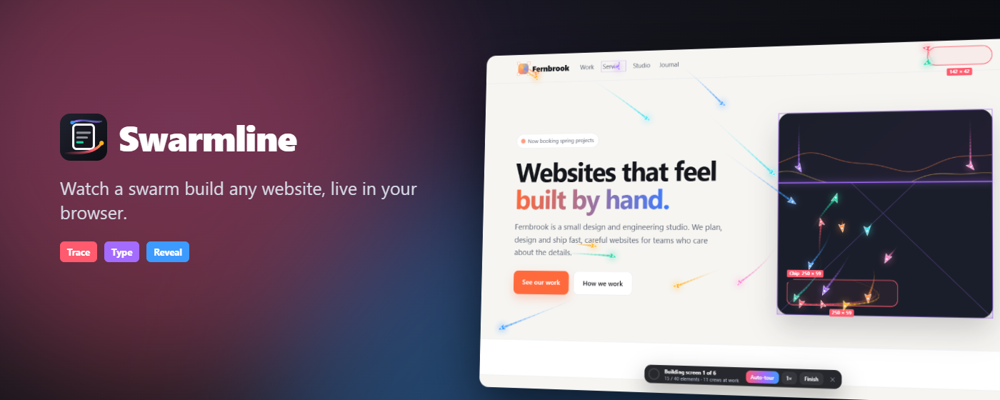

# Swarmline

**Watch a swarm build any website, live, in your browser.**



Swarmline is a Chrome extension. Click it on any page and the page becomes a blank canvas in its own colours. A swarm of glowing, colourful pen-nibs then builds it back in reading order: crews trace each box with a live size readout before it fills in for real, type every headline and paragraph letter by letter, and scan images into place. When a screen is done, the swarm rides a light sweep across it and Auto-tour glides straight on to the next. Between jobs the free nibs circle in two counter-rotating rings over the next section to be built.

Everything appears in place on the real page, so the result is always exactly the live site: its fonts, GSAP and CSS animations, video, canvases and links keep working throughout.

**Website:** https://tauquirshayaan.github.io/swarmline/ · **Privacy:** [PRIVACY.md](PRIVACY.md) · **License:** [MIT](LICENSE)

## Install (development)

1. Open `chrome://extensions` and turn on **Developer mode**.
2. Click **Load unpacked** and choose the [`extension/`](extension) folder (the one with `manifest.json`; not `dist/`).
3. Pin Swarmline from the puzzle-piece menu.

## Use

| | |
| --- | --- |
| **Alt+Shift+L** or the toolbar button | Start (again to stop) |
| **Auto-tour** / **T** | Glide through the page screen by screen (on by default; T turns it off) |
| **1× / 2× / 3×** | Build speed |
| **Finish** / **F** | Show the finished page now |
| **Esc** / **✕** | Exit (the page is restored exactly) |

Turn the tour off to scroll yourself: the swarm builds whatever comes to rest on screen. With *prefers-reduced-motion* it builds at 3× with a smaller swarm, and the tour jumps instead of gliding.

## How it works

[`swarmline.js`](extension/swarmline.js) is one dependency-free content script:

1. **Blank canvas.** The page fades to its own background colour. A small stylesheet hides every element (`visibility: hidden`, so the layout never moves) except the ones the swarm has put back, which carry a marker attribute. The page keeps running underneath.
2. **Scan.** When the page comes to rest, the visible part of the DOM (including open shadow roots) is read into *units*: boxes (anything that paints a background, border or shadow), text blocks (their real line boxes and letter positions, with split-text letters merged back into lines), media, form controls and icon-font glyphs.
3. **Build.** Units start in reading order, each with a crew of one to four nibs from the swarm. A crew traces a box's outline with a live size badge, then the real box fades in; text is typed by clipping the real element to the letters written so far (`clip-path: path(…)`) with a caret in the crew's colour; images and canvases scan in with a clip animation while the crew rides the scan line. A child waits for the box it sits in.
4. **Sweep.** When everything on screen is built, anything still hidden there (wrapper backgrounds, decoration) comes in top to bottom behind a light line that the idle swarm rides.
5. **Tour and finish.** Auto-tour eases to the next screen once the page is still. At the end the stylesheet and markers are removed, the swarm disperses, and the HUD shows a summary with **Replay**.

The swarm, outlines, badges and caret are drawn on a transparent `<canvas>` in a closed shadow root above the page. Exiting at any point (or any error) removes everything Swarmline added.

## Project layout

| Path | What it is |
| --- | --- |
| `extension/` | The extension: `manifest.json` (MV3, `activeTab` + `scripting` only), `background.js`, `swarmline.js`, `icons/` |
| `site/` | The public website: homepage, privacy policy, support (deployed to GitHub Pages) |
| `store/` | Store listing copy ([`LISTING.md`](store/LISTING.md)), icon, screenshots, promo tiles |
| `demo/index.html` | Self-contained demo page (a fictional studio) used for testing and store screenshots |
| `scripts/` | `make-assets.mjs` (graphics), `package.mjs` (store zip), `preflight.mjs` (pre-submission checks), `set-email.mjs` |
| `tests/` | `smoke.mjs` (runs it on a page with Auto-tour; frames, timings, frame rate) and `extension.mjs` (the real extension) |
| `PUBLISHING.md` | Step-by-step: from this folder to a live Web Store listing |

## Development

Needs Node.js 20+ and Chrome.

```sh
npm install
npm run check       # syntax check
npm run lint        # ESLint
npm test            # smoke test on the demo page
npm run test:site   # smoke test on a heavy real site (GSAP, Lenis, marquees)
npm run test:ext    # real extension test
npm run assets      # icons, screenshots, promo tiles, site images
npm run package     # dist/swarmline-<version>.zip
npm run preflight   # every check the store submission needs
```

## Publishing

See [PUBLISHING.md](PUBLISHING.md).

## Limits

- Chrome doesn't allow extensions on `chrome://` pages, the Web Store or the PDF viewer; the button shows a × there.
- The page can't be clicked while it's being built (so you can't hit a link you can't see); it's fully interactive again when the build finishes.
- Past about 3,000 elements the page is built in coarser pieces (the end-of-screen sweep still brings everything back).
